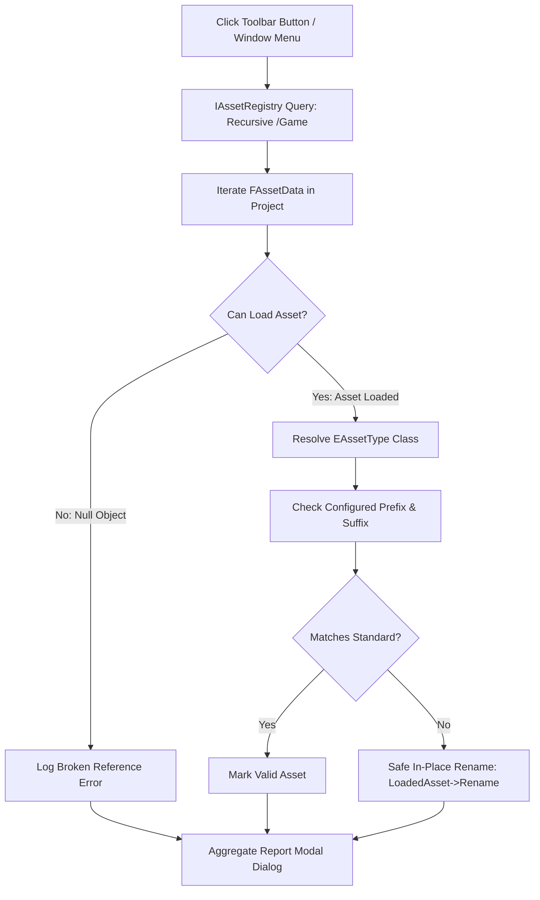

# Validate All Assets for Unreal Engine 5

[](https://www.unrealengine.com/)
[](README.md)
[](LICENSE)
[](https://www.linkedin.com/in/shankharaj-datta-45921a28a/)
[](#features--workflow)

A lightweight, 1-click Editor Utility plugin for Unreal Engine 5 (pre-compiled for **UE 5.3, 5.4, and 5.5**) that recursively audits your `/Game` directory for missing references, broken dependencies, and naming convention violations — with **automated prefix and suffix correction**.

> [!TIP]
> **Zero Compilation Required for Blueprint Users**: Pre-compiled Win64 editor binaries (`.dll` + `.modules`) are included for Unreal Engine 5.3, 5.4, and 5.5.

---

## 🛑 The Problem in Unreal Engine Projects

As game projects scale, asset hygiene quickly becomes a nightmare:
- **Packaging Failures & Build Breaks**: Ghost assets and missing references cause Cook & Package tasks to fail at 3:00 AM.
- **Messy Project Hierarchies**: Artists and designers import meshes, textures, and sounds with arbitrary naming (e.g., `rock_01` instead of `SM_Rock_01`), breaking project standards.
- **Manual Renaming Burnout**: Right-clicking and renaming hundreds of assets wastes hours of developer time.

**ValidateAllAssets solves this with a single click from your Level Editor Toolbar.**

---

## ✨ Features & Capabilities

- 🔍 **Missing Reference Detection**: Queries the `IAssetRegistry` to locate corrupted, deleted, or unresolvable assets before packaging.
- 🏷️ **Comprehensive Class Support**: Automatically categorizes assets across:
  - Blueprints (`BP_`)
  - Materials & Material Instances (`M_`, `MI_`)
  - Static Meshes (`SM_`) & Skeletal Meshes (`SK_`)
  - Textures (`T_`), Sounds (`S_`), Niagara Systems (`NS_`), Structures (`F_`), and Enums (`E_`).
- ⚡ **1-Click Auto-Fix Renaming**: Automatically fixes non-compliant asset names in-place via safe engine renaming (`LoadedAsset->Rename()`).
- 🛠️ **Configurable Project Settings**: Customize exact prefix and suffix rules per asset class in **Project Settings > Editor > ValidateAllAssetsSettings**.
- 📊 **Instant Summary Report**: Displays an executive modal dialog with exact counts of valid assets, broken references, and auto-corrected names.

---

## 🏛️ How It Works



---

## 📋 Installation & Quickstart

### 1. Installation
1. Choose the folder matching your engine version (`5.3`, `5.4`, or `5.5`).
2. Copy the inner `ValidateAllAssets` directory into your project's `Plugins/` folder:
   ```text
   YourProject/
   └── Plugins/
       └── ValidateAllAssets/
           ├── ValidateAllAssets.uplugin
           ├── Binaries/Win64/
           ├── Resources/
           └── Source/
   ```
3. Open Unreal Editor and verify the plugin is enabled under **Edit > Plugins > Editor > ValidateAllAssets**.

### 2. How to Run Validation
You can trigger validation via either of two access points:
- **Level Editor Toolbar**: Click the **Validate All Assets** icon directly on the main toolbar.
- **Window Menu**: Select **Window > Window Layout > Validate All Assets**.

### 3. Customizing Naming Rules
Navigate to **Edit > Project Settings > Editor > ValidateAllAssetsSettings**:
- Define custom prefixes (e.g., `SM_` for Static Meshes, `BP_` for Blueprints).
- Define custom suffixes (e.g., `_Inst` for Material Instances).

---

## 📊 Summary Output Dialog

Upon completing validation, a native editor notification provides an immediate audit breakdown:

```text
Asset validation complete.
------------------------------------
Valid Assets:        1,428
Missing References:      0
Missing Prefixes:       14 (Fixed: 14)
Missing Suffixes:        3 (Fixed: 3)
```

Detailed per-asset rename logs are simultaneously piped to the `Output Log` for full version-control auditability.

---

## 📄 License & Attribution

Distributed under the **MIT License**. See [LICENSE](LICENSE) for details.

Created by **[Shankharaj Datta](https://www.linkedin.com/in/shankharaj-datta-45921a28a/)**.
